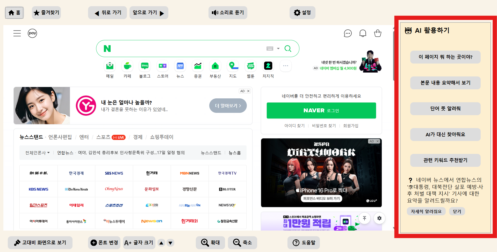
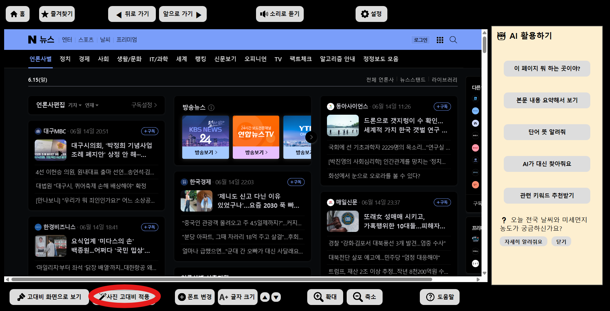
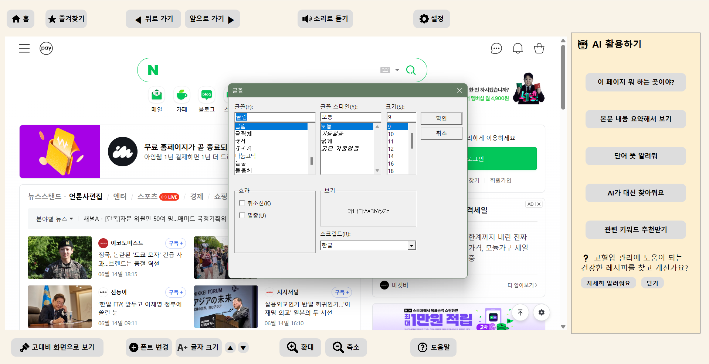
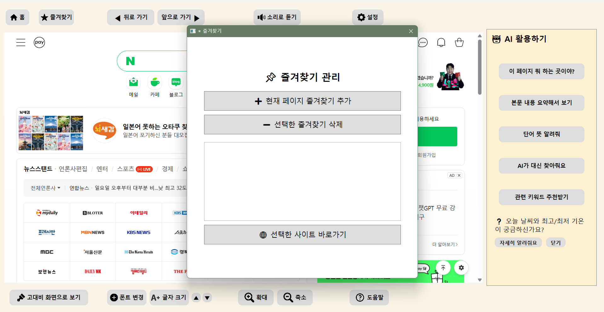
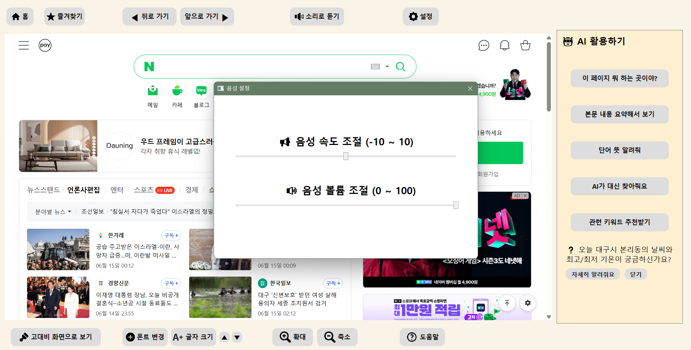
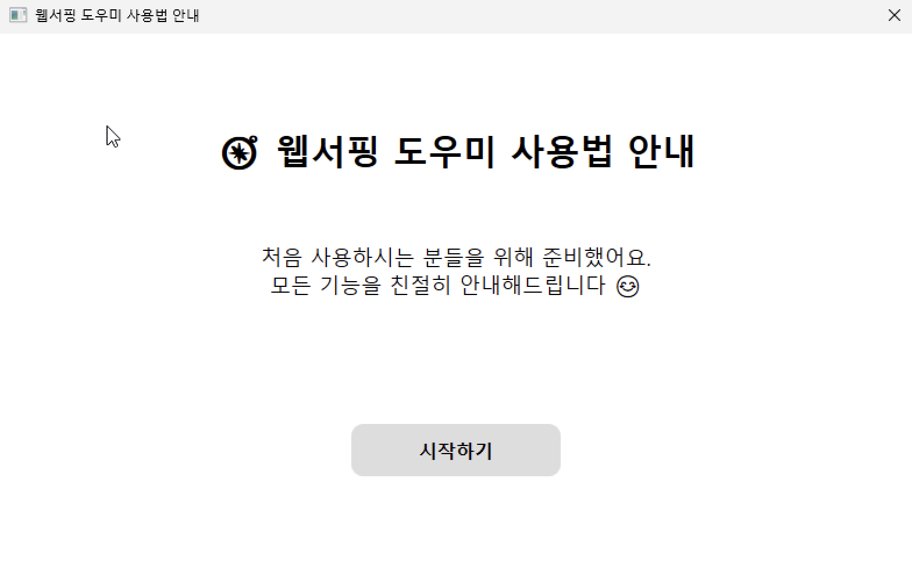
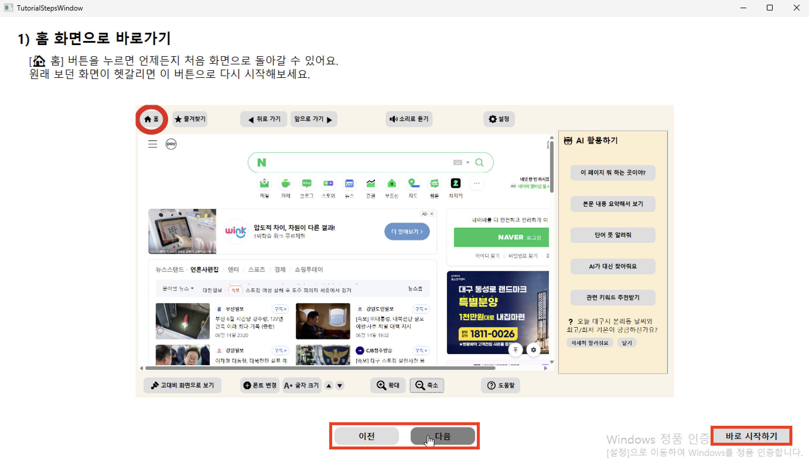
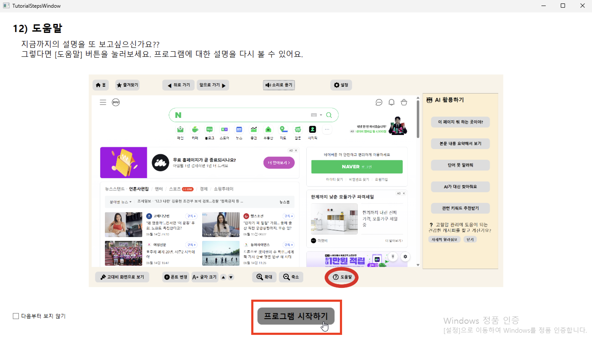
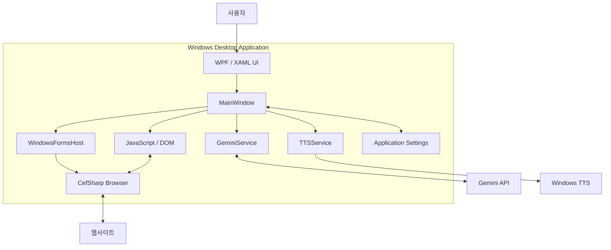

# 👵🖥️ 시니어를 위한 웹서핑 도우미

> **Web Surfing Helpers for Seniors**  
> **AI 요약·음성 안내·접근성 기능을 결합한 Windows 데스크톱 웹 브라우저**

웹페이지의 작은 글씨, 복잡한 정보 구조, 익숙하지 않은 검색 과정에 어려움을 겪는 시니어 사용자를 위해 개발한 **WPF 기반 웹서핑 지원 애플리케이션**입니다.

사용자는 웹을 탐색하면서 글꼴·글자 크기·화면 확대 등을 조절할 수 있으며, **Gemini 기반 AI 기능**으로 페이지 내용을 요약하거나 어려운 단어를 설명받을 수 있습니다. 또한 **Windows TTS**를 이용해 웹페이지의 텍스트를 음성으로 들을 수 있습니다.

---

## 📌 프로젝트 개요

| 항목 | 내용 |
| --- | --- |
| 프로젝트 | 시니어를 위한 웹서핑 도우미 (Web Surfing Helpers for Seniors) |
| 개발 기간 | 2025년 1학기 |
| 개발 형태 | 대학교 Windows 프로그래밍 교과목 팀 프로젝트 (2인) |
| 팀 구성 | 김나영, 장세연 |
| 플랫폼 | Windows 데스크톱 |
| 핵심 기술 | C#, WPF/XAML, .NET Framework 4.7.2, CefSharp, JavaScript/DOM, Gemini API, Windows TTS |
| 주요 목표 | 시니어의 웹 콘텐츠 이해 및 정보 접근 편의성 향상 |

---

## ✨ 주요 기능

### 1. 웹 브라우징 및 접근성 지원

- **기본 브라우징:** 홈, 뒤로 가기, 앞으로 가기, 주소 이동, 시작 페이지 지정
- **가독성 조절:** 웹페이지 글꼴 변경, 글자 크기 조절, 브라우저 확대·축소
- **고대비 모드:** 웹 콘텐츠의 색상 대비를 조절하고 이미지·영상 표시 방식을 선택적으로 제어
- **즐겨찾기:** 사이트 별칭을 지정해 저장하고, 목록에서 이동하거나 삭제
- **시니어 친화형 알림:** 큰 글자 및 명확한 버튼·아이콘으로 구성한 `CustomMessageBox`

### 2. Gemini 기반 AI 웹 콘텐츠 도우미

| 기능 | 설명 |
| --- | --- |
| 현재 사이트 안내 | 현재 접속한 웹사이트가 어떤 용도로 사용되는지 쉬운 말로 설명 |
| 웹페이지 요약 | 현재 페이지의 텍스트를 추출하여 주요 내용 요약 |
| 단어 뜻 풀이 | 사용자가 선택한 단어의 의미를 이해하기 쉽게 설명 |
| 쉬운 설명·추가 설명 | 이해하기 어려운 내용을 더 쉽게 풀거나 보충 설명 제공 |
| AI 질문·답변 | 사용자가 직접 입력한 질문에 답변 |
| 관련 검색 키워드 추천 | 웹페이지 내용과 연관된 검색 키워드 제안 |

기능별로 서로 다른 프롬프트를 구성하여, 시니어 사용자가 복잡한 웹 콘텐츠를 **단계적으로 이해하고 추가 질문을 이어갈 수 있도록** 설계했습니다.

### 3. 텍스트 음성 안내(TTS)

- 웹페이지에서 **직접 선택한 텍스트**를 음성으로 출력
- 선택한 내용이 없을 때 주요 DOM 요소에서 텍스트를 찾아 음성 출력 시도
- 음성 재생 및 중지, 속도·볼륨 조절
- 음성 재생 상태와 버튼 UI 연동

### 4. 사용 안내 및 설정

- 첫 실행 시 시각적 튜토리얼 제공
- 도움말 메뉴에서 단계별 사용 가이드 재실행
- 사용자 설정 및 즐겨찾기 데이터 저장과 복원

> **구현 범위 안내:** 튜토리얼은 시각적 단계 안내를 제공하며, 튜토리얼 자체의 음성 설명은 최종 버전에 포함되지 않았습니다. 일반 웹 콘텐츠에 대한 TTS 기능과는 별개입니다.

---

## 🖼️ 주요 화면 및 사용 시나리오

프로그램은 **웹 브라우저와 AI 도움말을 한 화면에서 함께 사용할 수 있도록** 설계했습니다. 아래 이미지는 실제 프로그램에서 캡처한 화면으로, 일부는 기능 위치를 표시하기 위해 강조 표시한 안내 이미지입니다.

### 메인 화면 — 웹 탐색과 AI 도움말



브라우저에서 웹페이지를 탐색하면서 오른쪽 AI 사이드바에서 **현재 사이트 소개, 본문 요약, 단어 설명, 질문·답변, 관련 검색어 추천** 등을 선택할 수 있습니다.

### 시니어를 위한 가독성·접근성 조절

| 고대비 모드 적용 | 글꼴 변경 |
| :---: | :---: |
|  |  |
| 웹페이지 대비 조절 | 글꼴 선택과 페이지 스타일 반영 |

### 자주 쓰는 사이트·음성 안내

| 즐겨찾기 관리 | 음성 설정 |
| :---: | :---: |
|  |  |
| 사이트 별칭 지정·삭제·이동 | 음성 출력 속도·볼륨 조절 |

### 기능별 사용 가이드 이미지

사용자가 기능을 쉽게 찾도록 만든 안내 화면도 별도로 확인할 수 있습니다. 이 이미지는 **실행 결과 화면보다는 사용법 안내에 가까우므로** 핵심 화면과 구분했습니다.

| 기능 | 안내 이미지 |
| --- | --- |
| 본문 요약 | [요약 메뉴 위치](WebSurfingHelpersForSenior/Assets/summation.png) |
| AI 검색 | [AI 질문 메뉴 위치](WebSurfingHelpersForSenior/Assets/AiSearch.png) |
| 관련 키워드 | [키워드 추천 메뉴 위치](WebSurfingHelpersForSenior/Assets/Keyword.png) |
| 화면 확대·축소 | [확대·축소 버튼 안내](WebSurfingHelpersForSenior/Assets/ZoomInOut.png) |
| 도움말 | [도움말 버튼 안내](WebSurfingHelpersForSenior/Assets/help.png) |

### 단계별 튜토리얼

프로그램을 처음 실행하는 사용자를 위해 단계별 사용 안내 기능을 구현했습니다.  
튜토리얼은 주요 버튼의 위치와 기능을 순서대로 설명하며, 사용자가 프로그램을 쉽게 익힐 수 있도록 돕습니다.  
또한 도움말 버튼을 통해 언제든지 다시 확인할 수 있습니다.

| 시작 화면 | 기능 안내 예시 | 도움말 및 다시보기 |
| :---: | :---: | :---: |
|  |  |  |
| 프로그램 사용법 안내 시작 화면 | 주요 기능을 단계별로 설명 | 도움말 버튼을 통해 튜토리얼 다시 보기 가능 |

---

## 🛠 기술 스택


| 구분 | 사용 기술 | 적용 내용 |
| --- | --- | --- |
| Desktop UI | C#, WPF, XAML | 메인 화면, 기능별 패널, 커스텀 알림·튜토리얼 |
| Runtime | .NET Framework 4.7.2 | Windows 애플리케이션 실행 환경 |
| Embedded Browser | CefSharp 136.1.40, CEF | Chromium 기반 웹페이지 렌더링 및 탐색 |
| UI Interop | WindowsFormsHost | WPF 내부에 CefSharp.WinForms 브라우저 호스팅 |
| Web Content | JavaScript, DOM API | 선택 텍스트 및 페이지 본문 추출, 화면 스타일 제어 |
| AI | Google Gemini API | 요약, 설명, 질의응답, 키워드 추천 |
| Network / JSON | HttpClient, System.Text.Json, Newtonsoft.Json | 비동기 API 요청·응답 처리 및 데이터 직렬화 |
| Speech | System.Speech / SpeechSynthesizer | 비동기 음성 출력·중지·속도·볼륨 |
| Persistence | .NET Application Settings | 사용자 설정 및 즐겨찾기 저장·복원 |
| Collaboration | Git, GitHub, Pull Request | 기능 브랜치 기반 협업 및 통합 테스트 |
| Distribution | MSI / Setup Wizard | Windows 설치 패키지 제작 및 별도 PC 설치 검증 |

---

## 🏗️ 시스템 구조

### 1. 기능 구성 — 최종보고서의 「전체 프로젝트 개요도」 기반

최종보고서에서는 전체 기능을 **다섯 개 영역**으로 구분했습니다. 아래는 해당 구성도를 README에서 읽기 쉽게 다시 정리한 것입니다.

| 영역 | 주요 구성 |
| --- | --- |
| **사용자 맞춤형 UI** | WPF/XAML 화면, 고대비 테마, 폰트·글자 크기 변경, 확대·축소 |
| **AI 요약 및 음성 안내** | 웹 텍스트 추출, Gemini API 기반 설명·요약, Windows TTS |
| **웹 브라우저 통합** | CefSharp 기반 웹페이지 렌더링, 선택 텍스트 및 DOM 접근 |
| **설정 및 데이터 저장** | 사용자 환경 설정 저장·복원, 즐겨찾기 |
| **튜토리얼 및 사용 안내** | 첫 실행 시 가이드, 도움말에서 안내 다시 보기 |

> 출처: 팀 최종보고서 3페이지 「전체 프로젝트 개요도」. 이 표는 **기능 분류도**이며, 아래는 실제 코드의 **기술 연결 구조**입니다.


### 2. 기술 구조 — 주요 구성 요소 및 연결 관계



**구성 요소별 역할**

| 구성 요소 | 역할 |
| --- | --- |
| **WPF / XAML UI** | 메인 화면, 브라우저 조작 버튼, AI 사이드바 및 결과 패널 구성 |
| **MainWindow** | 사용자 이벤트 처리 및 브라우저·AI·TTS 기능 호출 |
| **WindowsFormsHost** | WPF 내부에서 WinForms 기반 브라우저 컨트롤 호스팅 |
| **CefSharp Browser** | Chromium 기반 웹페이지 렌더링 및 탐색 |
| **JavaScript / DOM** | 웹페이지 텍스트 추출 및 스타일 변경 |
| **GeminiService** | AI 기능별 요청 생성, Gemini API 호출 및 응답 처리 |
| **TTSService** | Windows 음성 합성을 통한 텍스트 읽기 및 중지 |
| **Application Settings** | 사용자 환경 설정 저장 및 복원 |

**주요 데이터 처리 흐름**

1. 사용자가 WPF 화면에서 웹페이지에 접속하거나 AI·TTS 기능을 선택합니다.
2. `MainWindow`는 `WindowsFormsHost`에 연결된 CefSharp 브라우저를 제어합니다.
3. 웹 콘텐츠 처리가 필요한 경우 CefSharp의 JavaScript 실행 기능을 활용하여 DOM 데이터를 추출합니다.
4. AI 기능 실행 시 추출한 텍스트 또는 사용자 질문을 `GeminiService`에 전달하고, Gemini API 응답을 UI에 표시합니다.
5. 음성 안내 실행 시 선택하거나 추출한 텍스트를 `TTSService`에 전달하여 음성으로 출력합니다.
6. 사용자 환경 설정은 로컬에 저장하고 재실행 시 복원합니다.

> **참고 1:** `JavaScript / DOM`은 독립적인 C# 서비스가 아니라 CefSharp 브라우저 내부에서 수행되는 처리 과정입니다.  
> **참고 2:** 음성 읽기는 선택 텍스트 우선 및 다단계 DOM 탐색을 사용하지만, 웹페이지 요약은 `document.documentElement.innerText`를 사용하는 별도의 추출 경로를 사용합니다.

---

## 👤 담당 역할 및 기여

### 장세연 — WPF 기반 UI 구현 및 웹 콘텐츠 추출·AI·TTS 기능 연동 개발

**UI/UX 및 접근성**
- WPF/XAML 기반 메인 화면, 상단 브라우저 조작 버튼, AI 사이드바 및 기능별 결과 패널 설계·구현
- 사용자가 어떤 버튼을 누르고 어떤 결과 화면으로 이동할지에 대한 기능 실행 흐름 설계
- 브라우저 내 JavaScript 스타일 변경을 활용한 글꼴 및 글자 크기 조절 구현
- 큰 글씨·아이콘을 사용하는 시니어용 `CustomMessageBox` 구현

**Gemini AI 서비스**
- Gemini API 연동 및 기능별 프롬프트 설계·개선
- 사이트 용도 안내, 페이지 요약, 단어 뜻 풀이, 쉬운 설명·추가 설명, 사용자 질의응답 및 키워드 추천 구현
- `HttpClient`와 `async/await`를 사용한 비동기 API 호출 및 결과 표시 흐름 관리

**브라우저·웹 콘텐츠 처리**
- CefSharp 브라우저 통합 및 초기화, WPF의 `WindowsFormsHost`와 연결
- 홈·뒤로·앞으로·주소 이동 등 브라우징 기능 연결
- JavaScript·DOM 기반 선택 텍스트 추출 및 우선순위 기반 본문 탐색 구현
- 자동 텍스트 추출이 어려운 사이트를 위한 사용자 직접 선택 경로 제공

**음성·가이드·배포**
- Windows TTS 음성 출력·중지 및 비동기 상태 연동
- 즐겨찾기 추가·삭제·이동과 별칭 지정, 시작 페이지 지정 기능 구현
- 첫 실행 튜토리얼, 단계별 시각 안내 및 도움말 재실행 기능 구현
- Git 브랜치 및 Pull Request 기반 협업, 통합 테스트 참여
- MSI/Setup Wizard 설치 파일 제작 및 USB를 통한 별도 PC 설치·기능 검증

---

## 🔧 핵심 기술 구현 및 문제 해결

### 1. 서로 다른 웹사이트의 DOM 구조에서 읽을 텍스트 찾기

**문제**

웹사이트마다 HTML 구조와 주요 콘텐츠 영역이 달라 단일 CSS 선택자만으로 본문을 추출하기 어려웠습니다. 일부 페이지에서는 메뉴, 광고, 부가 정보가 본문과 함께 추출되기도 했습니다.

**접근 및 구현**

- 사용자가 직접 드래그한 텍스트를 우선 확인
- 접근 가능한 iframe 내부의 선택 영역과 WPF 결과 TextBox의 선택 텍스트 확인
- 선택된 텍스트가 없으면 `main` → `article` → `section` 순서로 주요 영역 탐색
- 적절한 영역이 없으면 텍스트가 긴 `div`를 탐색
- 최종 대체 경로로 `document.body.innerText` 활용
- 필요한 텍스트를 확보하지 못한 경우 사용자에게 직접 선택하도록 안내

```text
[소리로 듣기 클릭]
      |
      v
[브라우저에서 선택한 텍스트 확인]
      |
      +-- 있으면 --> [TTS 출력]
      |
      v
[접근 가능한 iframe / WPF TextBox 선택 내용 확인]
      |
      +-- 있으면 --> [TTS 출력]
      |
      v
[main → article → section 탐색]
      |
      v
[텍스트가 긴 div 탐색]
      |
      v
[body.innerText 대체 경로]
      |
      +-- 텍스트 있음 --> [TTS 출력]
      |
      +-- 텍스트 없음 --> [직접 선택 안내]
```

**결과 및 한계**

하나의 추출 방식에 의존하지 않고 선택 텍스트와 다단계 DOM 탐색을 조합해 다양한 웹페이지에 대응하도록 개선했습니다. 다만 사이트 구조에 따라 본문 이외의 내용이 섞일 수 있어 **모든 사이트에서 정확한 추출을 보장하지는 않습니다.** 최종보고서에서도 웹페이지 텍스트 추출·전처리를 보완이 필요한 항목으로 평가했습니다.

### 2. WPF 애플리케이션에 웹 브라우저와 AI·TTS 기능 통합

**기술적 과제**

Windows 데스크톱 UI 안에서 웹페이지를 렌더링하는 동시에, 웹페이지의 콘텐츠를 C#으로 전달해 AI 요약과 음성 출력에 활용해야 했습니다.

**접근 및 구현**

- 초기 WebView2를 검토했으나 패키지·런타임 통합 과정에서 어려움을 겪었다는 개발 당시 경험을 바탕으로 CefSharp 기반 구현을 선택
- 최종적으로 `WindowsFormsHost`에 `CefSharp.WinForms.ChromiumWebBrowser`를 연결
- `EvaluateScriptAsync()`로 웹페이지 내 선택 텍스트·콘텐츠를 C#에 전달
- `ExecuteScriptAsync()`로 웹페이지 글꼴 및 표시 속성을 제어
- 페이지 로딩 이벤트와 WPF UI 이벤트를 연계해 브라우저와 사용자 기능 통합

**결과**

독립적인 웹 브라우저, AI 기능, TTS 기능을 하나의 WPF 애플리케이션에서 사용할 수 있도록 구성했습니다.

> 확보된 Git 커밋에는 WebView2 관련 예외 로그나 패키지 제거 내역이 남아 있지 않습니다. 따라서 초기 WebView2 검토·통합 문제는 개발 경험에 근거한 설명이며, 오류의 정확한 원인이 검증된 것은 아닙니다. 두 라이브러리 간 렌더링 속도 우위는 측정하지 않았으므로 주장하지 않습니다.

### 3. 기능별 AI 프롬프트 및 비동기 결과 처리

**문제**

단순한 일반 질문·답변만으로는 웹페이지를 이해하기 어려워하는 사용자의 요구를 해결하기 부족했습니다. 또한 외부 API 응답에는 대기 시간이 발생할 수 있었습니다.

**접근 및 구현**

- 페이지 요약, 사이트 안내, 단어 설명, 추가 설명, 키워드 추천 등 사용 목적별 프롬프트 분리
- 각 기능에 필요한 URL·선택 단어·웹페이지 텍스트를 구분해 요청 데이터 구성
- `HttpClient` 및 `async/await` 기반 비동기 호출
- API 요청 중 진행 상태를 보여주는 로딩 표시와 기능별 결과 화면 제공
- 실패 시 오류 안내를 통해 사용자 흐름이 갑자기 끊기지 않도록 처리

**결과**

웹페이지 탐색 도중 사용자가 필요한 AI 기능을 선택하고 결과를 확인할 수 있는 일관된 흐름을 구현했습니다. 다만 AI 응답의 정확도나 사용자 이해도 향상에 대한 별도 정량 평가는 수행하지 않았습니다.

### 4. 사용 환경을 고려한 Windows 설치·동작 확인

**목표**

개발용 PC뿐만 아니라 비교적 사양이 낮은 Windows PC에서도 프로그램을 설치하고 주요 기능을 사용할 수 있는지 확인했습니다.

**검증 방법**

- MSI/Setup Wizard 방식으로 Windows 설치 패키지 제작
- USB로 설치 파일을 다른 데스크톱 PC에 전달
- 실제 설치 후 브라우징·AI·음성 기능 등 주요 동작 확인

| 검증 환경 | 사양 |
| --- | --- |
| 운영체제 | Windows 10 Pro 22H2 |
| CPU | Intel Core i3-4170 @ 3.70 GHz |
| 메모리 | 8GB RAM |
| 결과 | 설치 오류 없이 주요 기능 정상 동작 확인 |

> 위 결과는 **해당 PC에서의 기능 동작 확인**입니다. 렌더링 지연 시간, 메모리 사용량 또는 다양한 기종에서의 성능을 정량적으로 측정한 벤치마크 결과는 아닙니다.

---

## 📁 프로젝트 구조

```text
WebSurfingHelpersForSenior/
├── WebSurfingHelpersForSenior.sln
└── WebSurfingHelpersForSenior/
    ├── App.xaml / App.xaml.cs
    ├── MainWindow.xaml / MainWindow.xaml.cs
    ├── CustomMessageBox.xaml / .xaml.cs
    ├── FavoriteWindow.xaml / .xaml.cs
    ├── SetHomePageWindow.xaml / .xaml.cs
    ├── SettingsWindow.xaml / .xaml.cs
    ├── VoiceSettingsWindow.xaml / .xaml.cs
    ├── TutorialWindow.xaml / .xaml.cs
    ├── TutorialStepsWindow.xaml / .xaml.cs
    ├── services/
    │   ├── GeminiService.cs
    │   ├── TTSService.cs
    │   └── FavoritesStorage.cs
    ├── Properties/
    │   └── Settings.settings
    ├── Assets/
    ├── packages.config
    └── WebSurfingHelpersForSenior.csproj
```

---

## 🚀 개발 환경 및 실행

1. Windows 환경에 **Visual Studio 2022**와 **.NET 데스크톱 개발** 워크로드, **.NET Framework 4.7.2 개발자용 타기팅 팩**을 준비합니다.
2. 저장소를 클론하고 솔루션 파일(`WebSurfingHelpersForSenior.sln`)을 엽니다.
3. NuGet 패키지를 복원한 후 프로젝트를 빌드합니다.
4. Gemini API를 사용하는 기능은 **별도의 유효한 API 인증 정보**가 필요합니다.

```bash
git clone https://github.com/yoniyon03/WebSurfingHelpersForSenior.git
```

> **보안 주의:** 과거 소스코드 및 Git 이력에 Gemini API 키가 직접 포함된 버전이 있습니다. 해당 키는 폐기·교체하고, 공개 저장소 및 배포물에 비밀키가 포함되지 않도록 정리해야 합니다. 현재 클라이언트 코드에 키를 직접 넣는 방식은 안전한 배포 구조가 아니므로, 향후에는 서버 측 API 프록시 등을 통한 키 보호가 필요합니다. 또한 인증 정보 정리 전까지는 공개 배포를 권장하지 않습니다.

> 저장소에는 설치 패키지 자체가 포함되어 있지 않을 수 있습니다. 위 방법은 **소스코드 기준 개발 환경 설정 절차**이며, 모든 환경에서 별도 조정 없이 빌드·실행된다고 보장하지 않습니다.

---

## 🤝 협업 방식

- **개인 브랜치:** 팀원별 독립적인 브랜치에서 담당 기능 개발 및 수정
- **`master` 브랜치:** 각 브랜치에서 작업한 기능을 병합하여 프로젝트 코드 통합
- **통합 테스트:** 병합 후 기능 간 연동 및 전체 프로그램의 정상 동작 확인

---

## 📈 한계 및 향후 개선

- **DOM 추출 범용성:** 광고·메뉴가 혼합된 복잡한 사이트에서도 본문을 안정적으로 찾도록 추출 규칙 보완
- **AI 입력 품질:** 페이지 전체 텍스트를 전달하는 요약 방식에 본문 정제·길이 제한 등의 전처리 추가
- **튜토리얼:** 시각 안내 외 음성 안내 및 실제 사용성 검증 확장
- **보안:** Gemini API 키를 클라이언트에서 제거하고 서버 측 요청 구조로 전환
- **품질 검증:** 웹사이트 유형별 추출 성공률, AI 응답 시간, 저사양 PC 자원 사용량 등을 정량적으로 측정

---

## 💭 회고

이 프로젝트에서 가장 중요했던 경험은 **웹페이지를 보여주는 기능 자체보다, 웹 콘텐츠를 사용자가 이해하고 활용할 수 있도록 데스크톱 UI·DOM 처리·AI·음성 기능을 연결한 과정**이었습니다.

특히 웹사이트마다 다른 DOM 구조로 인해 본문 추출 결과가 일관되지 않는 문제를 경험했고, 주요 태그 탐색과 대체 경로를 함께 사용하는 방식으로 개선했습니다. 또한 별도의 Windows PC에 설치 파일을 배포·검증하면서 **개발 환경 밖에서 실제로 동작하는 소프트웨어를 만드는 과정**의 중요성을 배웠습니다.

---

**팀 프로젝트:** 김나영 · 장세연  
**저장소:** [WebSurfingHelpersForSenior](https://github.com/yoniyon03/WebSurfingHelpersForSenior)
